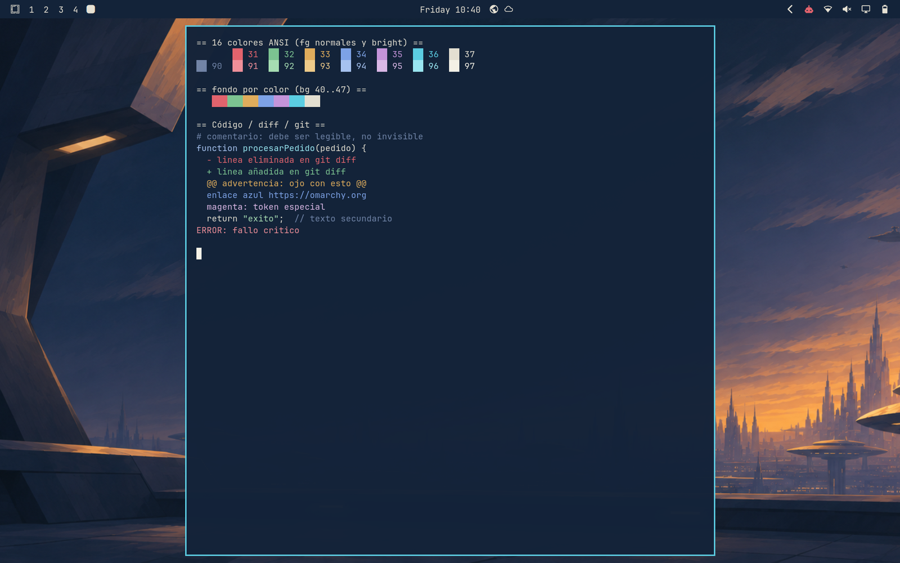

# CloneWars — tema para Omarchy

Tema oscuro para [Omarchy](https://omarchy.org) inspirado en la estética de *Star Wars: The Clone Wars*: ciudades al atardecer, hangares orbitales, desiertos y plataformas sobre el océano. Diseñado para programación y trabajo diario con terminales y agentes.



## Aspecto y paleta

- **Fondo azul marino profundo** derivado de los cielos nocturnos de los fondos.
- **Azul pizarra** para superficies elevadas, texto secundario y comentarios.
- **Texto claro ligeramente cálido** (crema), cómodo para sesiones largas de código.
- **Cian** como acento principal: bordes de ventana activa, barra, lanzador, notificaciones, indicadores y selección en menús.
- **Ámbar** como acento secundario: advertencias y tonos cálidos en el terminal.
- Bordes de ventana: cian sólido en la ventana activa y pizarra apagada en las inactivas.

Paleta principal:

| Uso | Color | Hex |
|-----|-------|-----|
| Fondo | azul marino | `#132339` |
| Fondo más profundo | azul noche | `#0B1626` |
| Superficies | azul pizarra | `#20344E` |
| Texto | crema cálido | `#E6E1D3` |
| Texto secundario / comentarios | pizarra | `#7184A8` |
| Acento principal | cian | `#5CCFE4` |
| Acento secundario | ámbar | `#E2AE5C` |
| Errores | rojo | `#E4646E` |
| Éxitos | verde | `#7EC592` |
| Enlaces / palabras clave | azul | `#7FA3E8` |
| Selección | azul pizarra | `#2E4568` |

Colores ANSI del terminal (16 colores completos), definidos en `colors.toml`:

| ANSI | Hex | ANSI | Hex |
|------|-----|------|-----|
| 0 · negro | `#132339` | 8 · gris (comentarios) | `#7184A8` |
| 1 · rojo | `#E4646E` | 9 · rojo brillante | `#F2909A` |
| 2 · verde | `#7EC592` | 10 · verde brillante | `#A9DEB4` |
| 3 · amarillo | `#E2AE5C` | 11 · amarillo brillante | `#F2CC8A` |
| 4 · azul | `#7FA3E8` | 12 · azul brillante | `#A9C4F2` |
| 5 · magenta | `#C795DB` | 13 · magenta brillante | `#DDBAE8` |
| 6 · cian | `#5CCFE4` | 14 · cian brillante | `#9BE9F4` |
| 7 · blanco | `#E6E1D3` | 15 · blanco brillante | `#F8F4E8` |

La paleta completa pasó una revisión de contraste (WCAG) para legibilidad: cuerpo de texto >12:1, comentarios ~4:1 y cada color ANSI ≥4:1 sobre el fondo.

## Versión de Omarchy probada

Probado con **Omarchy 4.5.0-3** (canal estable).

El tema usa únicamente `colors.toml` como fuente de la paleta, de modo que Omarchy genera automáticamente la configuración de terminal (Foot, Alacritty, Ghostty, Kitty), btop, Chromium, Hyprland (bordes), Neovim (colorscheme `aether`), Helix, VS Code, Obsidian y todo el shell de Omarchy (barra, lanzador, menús, notificaciones, OSD y pantalla de bloqueo).

No incluye archivos `.lua`, configuraciones de terminal ni `vscode.json`: todo lo que un tema instalado desde un repositorio no puede aportar se genera desde `colors.toml` en tu máquina.

## Instalación

Con el comando de Omarchy (también disponible desde el menú: *Install > Style > Theme*):

```bash
omarchy theme install https://github.com/aivm23/omarchy-clonewars-theme.git
```

El tema se clona en `~/.config/omarchy/themes/clonewars` y se aplica automáticamente.

## Selección del tema y cambio de fondo

```bash
# Aplicar el tema
omarchy theme set clonewars

# Ver el tema y el fondo actuales
omarchy theme current
omarchy theme bg current

# Cambiar al siguiente fondo (4 en total, cicla)
omarchy theme bg next

# Cambiar un fondo concreto
omarchy theme bg set ~/.config/omarchy/themes/clonewars/backgrounds/3-hangar-orbital.png
```

También puedes cambiar de tema y fondo desde el menú de Omarchy (`Super + Alt + Space`).

Fondos incluidos (generados con IA, ver más abajo):

1. `1-ciudad-atardecer.png` — ciudad al atardecer (fondo inicial)
2. `2-santuario-desierto.png` — santuario en un desierto al crepúsculo
3. `3-hangar-orbital.png` — hangar orbital sobre un planeta azul
4. `4-plataformas-oceano.png` — plataformas de laboratorio sobre el océano

## Volver al tema anterior

El instalador recuerda el tema y el fondo que tenías. Para volver a cualquier tema anterior basta con aplicarlo de nuevo, por ejemplo:

```bash
omarchy theme set <tema-anterior>   # p. ej. osaka-jade, tokyo-night, catppuccin...
omarchy theme list                 # ver todos los disponibles
```

Al cambiar de vuelta, Omarchy restaura automáticamente el fondo que tenías en ese tema. Si quieres fijar otro fondo en CloneWars antes de irte, usa `omarchy theme bg set <archivo>`; se recordará para la próxima visita.

Para desinstalar CloneWars por completo: `omarchy theme remove clonewars`.

## Limitaciones conocidas

- **TUIs basadas en el terminal** (opencode, lazygit, etc.) heredan la paleta al arrancar; si ya estaban abiertas durante el cambio de tema, ciérralas y ábrelas de nuevo para ver la paleta nueva.
- Sin vídeo de introducción al cambiar de fondo ni imagen de desbloqueo (`unlock.png`): el tema no aparece en *Appearance > Unlock*, pero la pantalla de bloqueo se colorea con la paleta.
- Los iconos del sistema se fijan a `Yaru-sage` vía `icons.theme`.
- Probado en una instalación con una sola pantalla; no se ha verificado el comportamiento con múltiples monitores ni con waybar/GTK fuera de lo que Omarchy gestiona por defecto.

## Procedencia de los fondos

Los cuatro fondos son **imágenes generadas con IA** (sin base reutilizada de terceros), creadas por el autor del tema para su uso personal y para [aivm23.com](https://aivm23.com). Se publican aquí tal cual, sin retocar.

Este tema es un trabajo de fan no oficial inspirado en la estética de *Star Wars: The Clone Wars*. **Sin afiliación con Lucasfilm ni Star Wars.** No incluye material con copyright de Lucasfilm: solo paletas de color, configuración y las imágenes generadas con IA mencionadas arriba.

## Licencia

[MIT](LICENSE)
